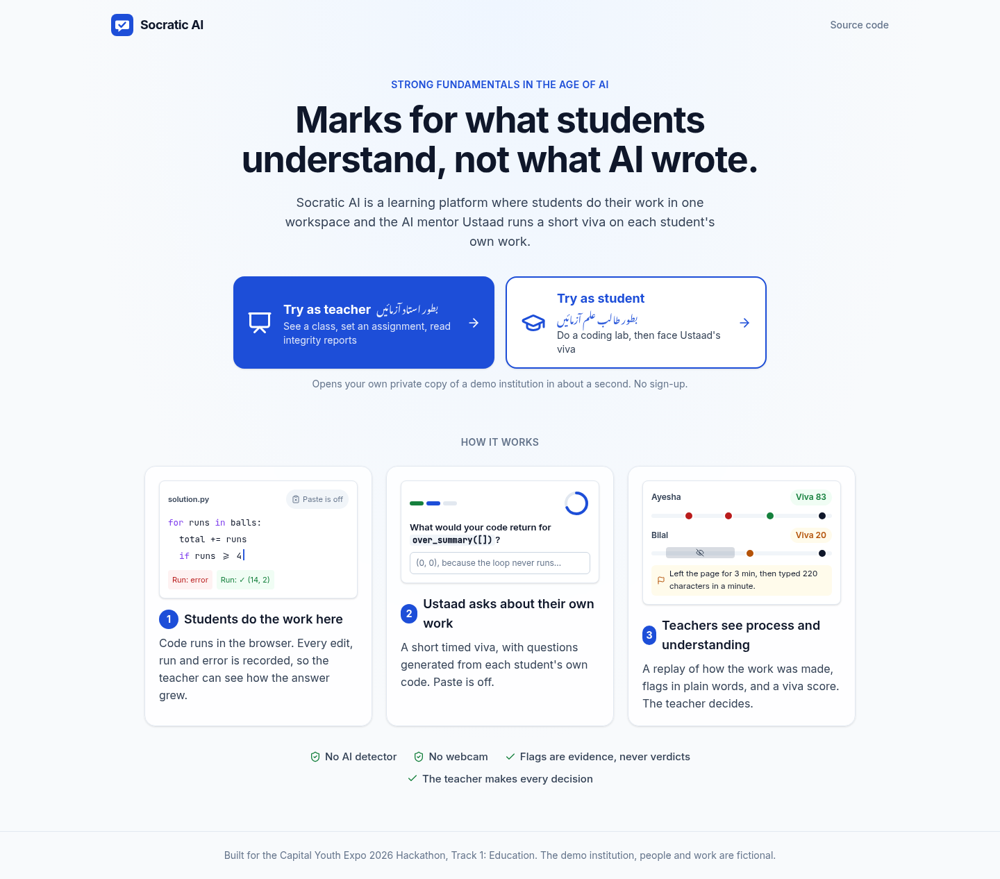
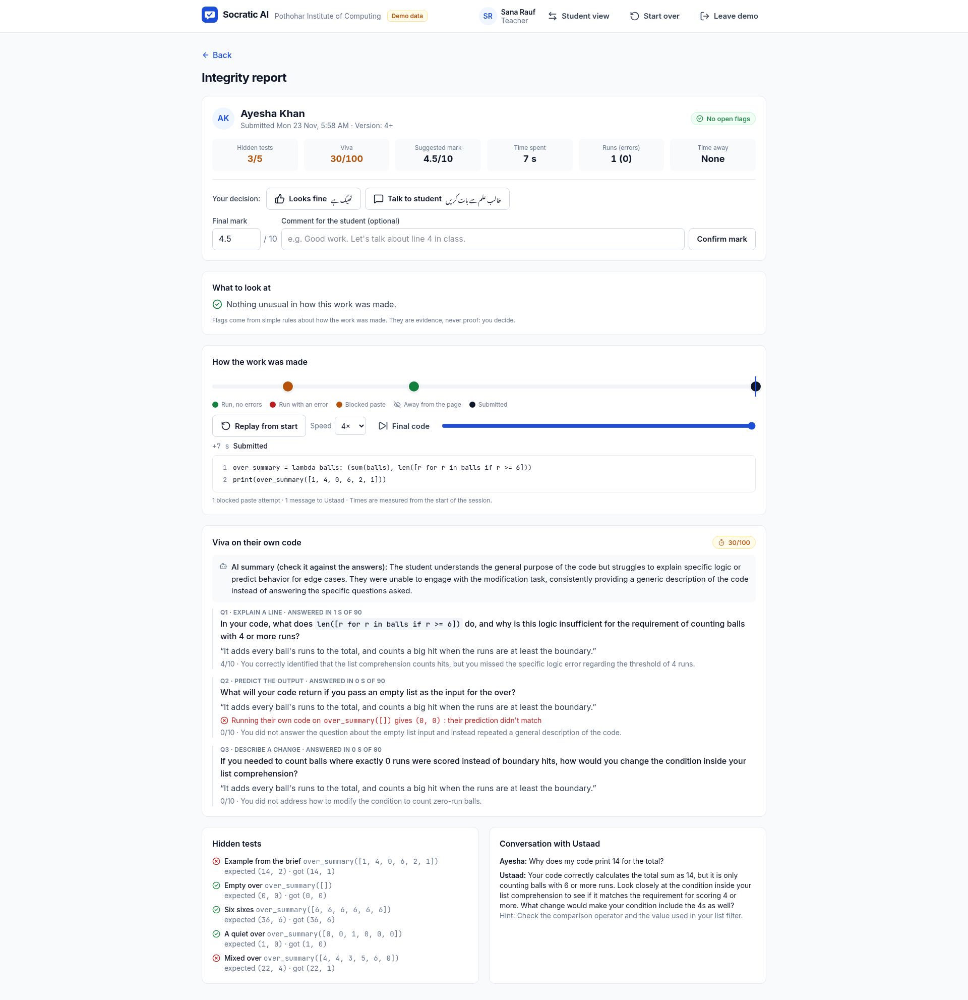
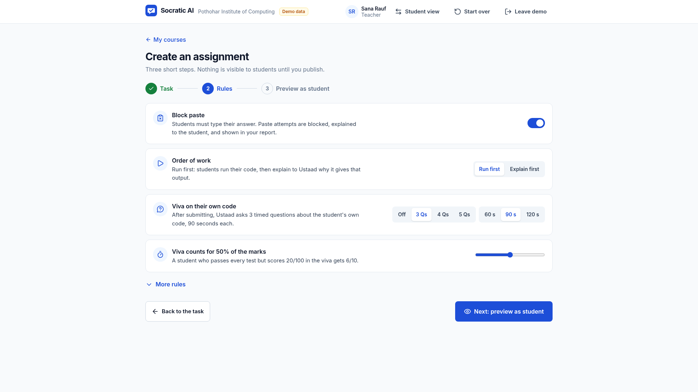
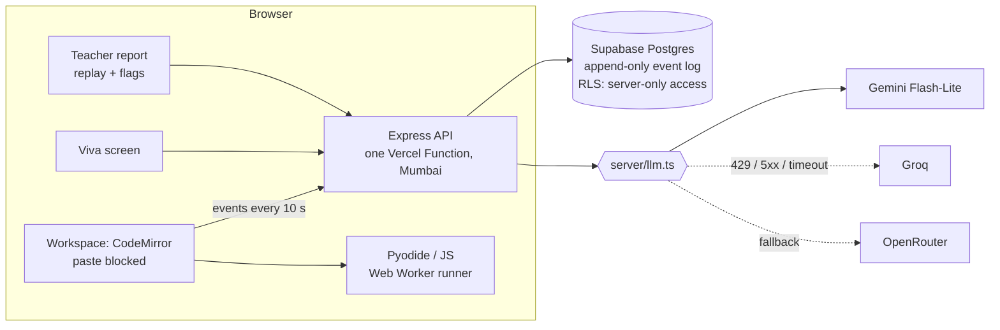

# Socratic AI: Strong Fundamentals in the Age of AI

**Live demo: https://socratic-ai-pk.vercel.app** · no sign-up · [health check](https://socratic-ai-pk.vercel.app/api/health)

A learning platform where students do their work in one workspace and the AI mentor **Ustaad** runs a short viva on each student's own work, so marks reflect what they understand.

> *We can't stop a student from asking AI. We make sure they can't get marks for work they don't understand.*

Built for the **Capital Youth Expo 2026 Hackathon (04-HK), Track 1: Education**, between Nov 16 and Nov 28, 2026.



---

## Try it in 60 seconds

1. Open **https://socratic-ai-pk.vercel.app** and click **Try as student**. You get your own private copy of a demo institution in about a second.
2. Open **Cricket Over Tracker**. Try pasting code (it's blocked, and the platform tells you why), type a solution, click **Run my code**, and ask **Ustaad** for a hint.
3. Click **Submit**: the hidden tests run, then Ustaad asks **3 timed questions about your own code**.
4. On the results screen, click **See what your teacher sees**: your own work as an integrity report, with a replay of how you wrote it.
5. Or start with **Try as teacher**: create an assignment from a template in three steps, open the gradebook, or compare two submissions side by side.

Everything in the demo (the institution, people and their work) is fictional and labelled **Demo data**.

---

## The problem

- **AI writes the homework.** A student can paste any lab into ChatGPT and submit a polished answer in minutes. The teacher sees the same output whether the student learned or not.
- **AI detectors are unreliable and unfair.** A Stanford study found that seven popular detectors flagged, on average, 61% of essays by non-native English writers as AI-generated ([Stanford HAI](https://hai.stanford.edu/news/ai-detectors-biased-against-non-native-english-writers)). Almost every Pakistani student writes in a second language.
- **HEC's draft policy** says students must not present AI work as their own, and that no student may be punished on a detection report alone ([HEC framework](https://www.hec.gov.pk//english/policies/Pages/Framework-GenAI.aspx)).
- **Vivas work but don't scale.** Asking students to explain their work is the fix teachers trust, but a teacher with 180 students can't run 180 vivas a week.

## What's new: verify learning, don't detect AI

Socratic AI stacks three layers. Any one can be beaten; beating all three is more work than doing the assignment honestly.

| Layer | What it does | What it catches |
| --- | --- | --- |
| **Controlled workspace** | Paste and drag-drop are blocked (with an explanation), the task can't be copied, each student gets their own version of the question | Copy-paste, shared answers |
| **Process evidence** | Every edit, run, error and time away from the page is recorded in an append-only log the student can't edit; the teacher can replay it | Answers retyped from a phone: one steady burst, no runs, often after a long absence |
| **A viva on the student's own work** | After submitting, Ustaad asks 3 timed questions generated from **that student's own code or text**: explain a line, predict an output, describe a change | Work the student doesn't understand |

What makes the viva hard to game:

- **Ground truth, not opinion.** For the "predict the output" question, the student's own code is run on the new input after they answer. A wrong prediction can't score high, whatever the AI scorer thinks.
- **Fair to second-language writers.** The scorer is instructed to grade ideas, never English. Roman Urdu answers count fully.
- **The teacher decides.** Flags are plain sentences ("Left the page for 3 min 10 s, then typed 220 characters within a minute of coming back"), each with a **Show me** link into the replay. There's no AI-text detector, no webcam and no automatic penalty.

## Screens

| Student workspace | The viva |
| --- | --- |
|  |  |

| Teacher's integrity report | Assignment builder: rules |
| --- | --- |
|  |  |

## How Socratic AI meets the judging criteria

Using the rulebook's own words:

| Criterion | Where to see it |
| --- | --- |
| **Innovation & Creativity**: *novelty of the approach and creativity in addressing the track's problem* | Verifies learning instead of detecting AI: process replay plus an automated viva on each student's own work, with ground-truth checks by running the student's code. Per-student question variants. No detector, no webcam |
| **Technical Execution & Functionality**: *working status of the live prototype, system stability, and effective integration of code/AI/APIs* | The live link runs end to end: Python (Pyodide) and JavaScript run in Web Workers with a 5 s safety stop; an append-only event log enforced by database triggers; Gemini → Groq → OpenRouter fallback with schema-validated JSON; hidden tests whose answers never reach the browser; private demo sandboxes in under a second; 49 unit tests and a 36-step browser test run against production |
| **Real-World Impact & Viability**: *practical usefulness, scalability, and potential to solve real community, campus, or industry needs* | Automates a practice teachers already trust (the viva); aligned with HEC's rule against detector-only punishment; runs in any browser on lab PCs that universities already have; code runs on the student's machine, so the server stays cheap. Measured results: see below |
| **Presentation, UI/UX & Pitch Clarity**: *user interface quality, clarity of the live demonstration, and effectiveness of the 5-minute pitch* | Designed with Norman, Nielsen and Shneiderman: a five-step journey stepper, one primary action per screen, buttons that say what will happen, inline explanations when something is blocked, a consistent colour language (always with an icon and words), Urdu labels on key actions, and a landing page that explains itself in five seconds |

## Measured results

The real test with 10 students and 1–2 teachers (honest versus copied submissions, plus five-second interface tests) runs on **Thursday, Nov 26, 2026**. The results will be reported here exactly as measured. Until then, there are no numbers to report.

## Features

**Students:** courses with weekly notes and announcements · coding labs in **Python and JavaScript** and **written answers** · a five-step journey (Understand → Write → Run → Explain → Submit + viva) · paste blocking with explanations · autosave ("Saved 3 s ago") · Ustaad's Socratic hints in English or Roman Urdu · hidden tests · a timed viva · results with "what to revise next" and the teacher's confirmed mark.

**Teachers:** an assignment builder (Task → Rules → Preview as student) with a template library, where expected test answers are computed by running your own solution · rules as toggle cards (paste, order of work, viva length and weighting, per-student variants) · submissions with flagged work first · an integrity report (story timeline, replay, flags with **Show me**, viva transcript with ground-truth checks) · side-by-side comparison · **Looks fine / Talk to student** · confirm or change any mark with a comment · a gradebook with average viva per assignment and CSV export.

**Demo:** one-click **Try as teacher** and **Try as student**, each a private sandbox · **See what your teacher sees** · **Start over** · a nightly reset.

## How it works



- **Integrity of evidence.** Process events are batched every 10 s, timestamped by the database, idempotent on `(submission, seq)` and append-only: a trigger refuses every update, and refuses deletes outside the nightly reset. The browser can't read the database at all; every table is locked to the server.
- **Hidden tests.** Test *inputs* reach the browser only after the code is locked at Submit. The browser runs them; the **server** compares the results with expected answers that never leave it.
- **AI.** `server/llm.ts` is the only module that calls a model. Every reply is validated against a schema; on failure it retries, then falls back to the next provider; if all providers are down, the viva builds questions from real lines of the student's code. Student content is fenced as data, so instructions hidden in code comments are ignored.
- **Demo sandboxes.** Each "Try as…" click copies the seed institution into a private sandbox in about 0.25 s (heavy event logs are shared, not copied), with dates shifted so deadlines always look current.

Formats and rules: [`docs/event-format.md`](docs/event-format.md) · full specification: [`docs/proposal.md`](docs/proposal.md).

## Integrity without surveillance: the honest limits

- **A second phone can't be blocked.** It can be made useless: retyping leaves a fingerprint in the replay, variants make shared answers wrong, and the timed viva on the student's own work carries the marks.
- **Someone else doing the work and the viva** while logged in as the student needs identity checks; high-stakes exams belong in a lab with an invigilator.
- **Flags can be wrong.** That's why they are evidence for the teacher, never verdicts.

## Run it locally

```bash
npm install                     # also installs the pre-commit secret check
cp .env.example .env.local      # fill in keys (the app runs without AI keys; AI features then show a friendly message)
npm run dev                     # http://localhost:3000
npm run lint && npm test && npm run build
npm run smoke:ui -- http://localhost:3000     # headless Chrome: the full student and teacher journey
```

## Deployment

One Vercel project (Hobby) serves the Vite front end from its CDN and the Express API as a single function in Mumbai (`bom1`), next to two Supabase Postgres projects (production and preview). Every push to `main` deploys; every pull request gets a preview link. A daily cron (`/api/cron/reset-demo`, 03:00 PKT, secret-protected) clears expired demo sandboxes. Keys live only in Vercel; a pre-commit hook and GitHub push protection block secrets from the repository.

## Testing

- **Unit tests** (`npm test`, 49): integrity flags (an honest session raises none; a retyped one raises the right four), grading, per-variant marking, viva safety checks, event validation and replay, session cookies, the AI fallback chain, and expected-value computation.
- **Browser test** (`npm run smoke:ui`, 36 steps, fails on any console error): the student journey (JavaScript and Python labs, a written task, paste blocking, autosave, Ustaad, submit, hidden tests, viva, results), then the teacher's report, decision, mark, gradebook and builder.
- **End-to-end AI check** (`npm run e2e:viva`): simulated honest and copying students through the real API and AI. This is an engineering check only, never presented as a result.

## Third-party APIs and libraries

Every external service, model and library used in this repository is listed here, as the competition rules require.

| Name | What we use it for | Licence / terms |
| --- | --- | --- |
| [Vercel](https://vercel.com) | Hosting: CDN for the front end, a serverless function for the API, cron | Hobby plan |
| [Supabase](https://supabase.com) | Postgres database | Free plan |
| [Google Gemini API](https://ai.google.dev) (`gemini-3.1-flash-lite`) | Primary AI model for Ustaad and the viva | Google AI Studio free tier |
| [Groq API](https://groq.com) (`openai/gpt-oss-120b`) | First automatic fallback AI model | Groq free tier |
| [OpenRouter](https://openrouter.ai) (`google/gemini-3.1-flash-lite`) | Second automatic fallback AI model | OpenRouter terms |
| [React](https://react.dev) 19 | User interface | MIT |
| [Vite](https://vite.dev) + `@vitejs/plugin-react` | Front-end build and dev server | MIT |
| [Express](https://expressjs.com) 5 | API server | MIT |
| [TypeScript](https://www.typescriptlang.org) | Type checking | Apache-2.0 |
| [tsx](https://tsx.is) | Runs TypeScript in local development | MIT |
| [Vitest](https://vitest.dev) | Unit tests | MIT |
| [Zod](https://zod.dev) | Validates process events and AI responses | MIT |
| [Tailwind CSS](https://tailwindcss.com) 4 | Styling and design tokens | MIT |
| [React Router](https://reactrouter.com) | Page routing | MIT |
| [Lucide](https://lucide.dev) (`lucide-react`) | Icons | ISC |
| [CodeMirror 6](https://codemirror.net) | Code editor in the student workspace (with paste blocking) | MIT |
| [Motion](https://motion.dev) | Small feedback animations (a step completing, a result appearing) | MIT |
| [Pyodide](https://pyodide.org) (jsDelivr CDN in the browser; npm for the seed script) | Runs students' Python in a Web Worker; computes hidden-test answers when seeding | MPL-2.0 |
| [Inter](https://rsms.me/inter/), [JetBrains Mono](https://www.jetbrains.com/lp/mono/), [Noto Nastaliq Urdu](https://fonts.google.com/noto/specimen/Noto+Nastaliq+Urdu) (Google Fonts) | Interface, code and Urdu fonts | SIL Open Font License |
| [Puppeteer](https://pptr.dev) (`puppeteer-core`) | Browser smoke tests (development only) | Apache-2.0 |
| [Supabase CLI](https://supabase.com/docs/guides/cli) | Applies database migrations and seeds (development tool, run with `npx`) | MIT |

### AI coding assistants

The rules allow AI coding assistants as long as they are disclosed. We use:

- **Claude Code** (Anthropic): coding assistant throughout the build.
- **Google AI Studio**: the team's first prototype (Ustaad mentor, in-browser code runner, report) was generated in AI Studio on Nov 22, 2026, inside the build window. It is kept unchanged in [`prototype/`](prototype/) as its own commit, so the history shows exactly what came from it; it isn't built or deployed.

## Originality

All application code was written between Nov 22 and Nov 28, 2026, inside the official build window (Nov 16–28). The commit history and the merged pull requests show how it was built, step by step.

## Team

Five students; names, roles and institutions to be added.
