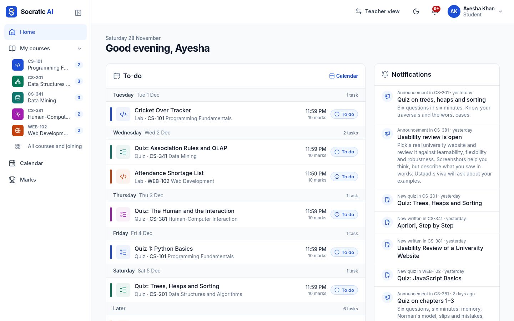
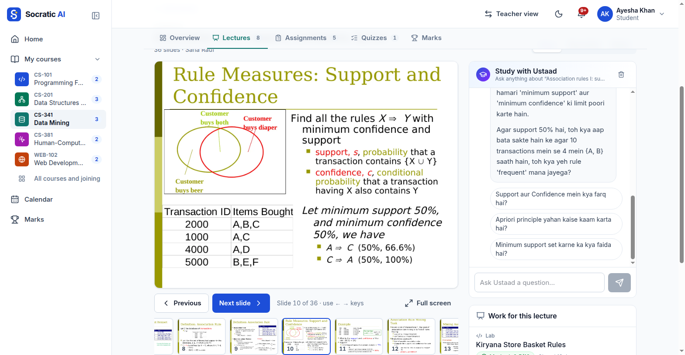
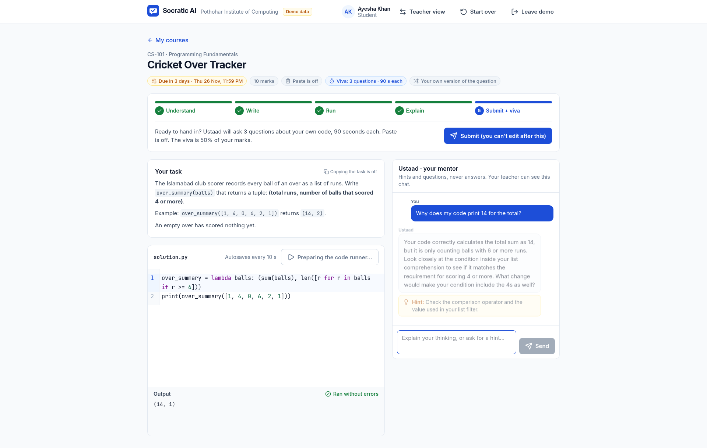
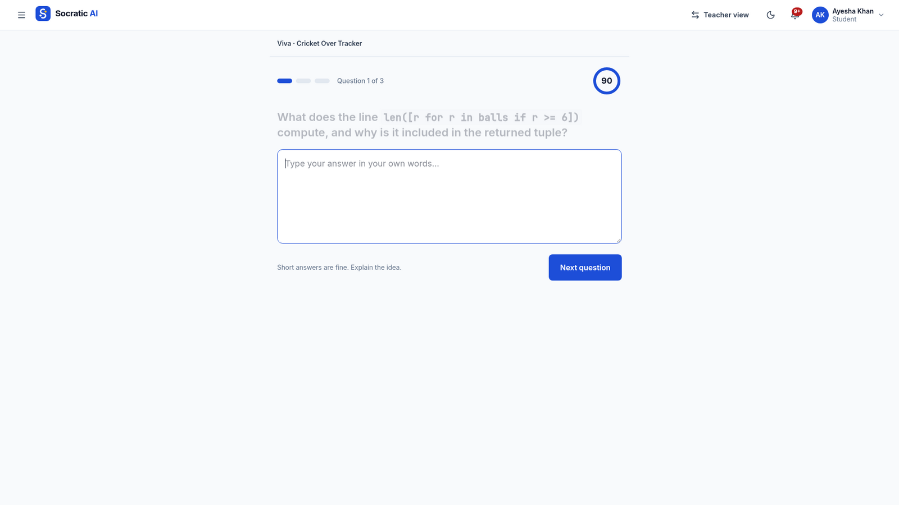
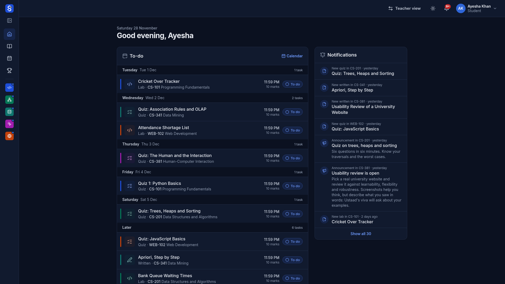
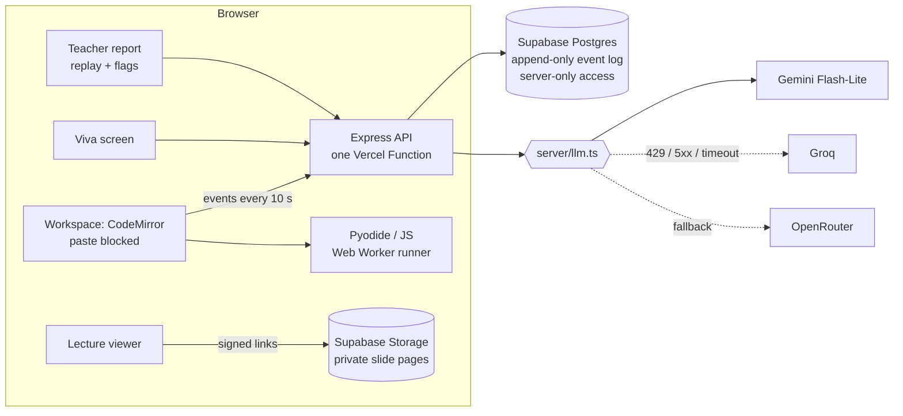

<p align="center"></p>

<h1 align="center">Socratic AI</h1>
<p align="center"><b>Strong Fundamentals in the Age of AI</b></p>

<p align="center">
  <b><a href="https://socratic-ai-pk.vercel.app">socratic-ai-pk.vercel.app</a></b> · open it and click <b>Try as student</b> or <b>Try as teacher</b>, no sign-up ·
  <a href="https://socratic-ai-pk.vercel.app/api/health">live health check</a>
</p>

One organized learning platform for students and teachers: courses, weekly material, assignments, coding labs, quizzes and marks in one place, with the AI mentor **Ustaad** making sure every mark reflects real understanding.

> *Everything a course needs in one place, and marks that mean the student really understood.*

Built for the **Capital Youth Expo 2026 Hackathon (04-HK), Track 1: Education**, between Nov 16 and Nov 28, 2026.


---

## A tour in 60 seconds

1. Open **https://socratic-ai-pk.vercel.app** and click **Try as student**. In about a second you're Ayesha, a computer science student with five courses and a semester's work.
2. **Home** shows only what matters today: a to-do list by due date across every course, and notifications (new work, marks, announcements). Every course is one click away in the sidebar under **My courses**.
3. Open **Data Mining → Lectures → Lecture 4**. The lecture opens with the teacher's own slide deck. Ask **Study with Ustaad** to *explain this slide*: it reads the slide on screen and answers in English or Roman Urdu.
4. Open a lab. Pasting is blocked (and the page says why), **Run my code** runs Python in your browser, and Ustaad gives hints and questions, never answers. Drag the edge of Ustaad's panel to make it wider.
5. **Submit**: hidden tests run, then Ustaad asks **3 timed questions about your own code**. Try a **timed quiz** or a **written answer** too.
6. Switch to **Teacher view** (top bar): courses, a gradebook, an assignment builder, and for every submission a report with a replay of how the work was made, flags in plain words and the viva transcript.

The top bar also has a **light/dark** switch, and the sidebar folds into an icon rail.

---

## The problem

- **A course lives in five places.** In a typical Pakistani university course, announcements are in a WhatsApp group, slides are PDFs on an LMS, assignments are emailed, quizzes are on Google Forms and marks are in the teacher's Excel sheet. Students miss deadlines; teachers repeat the same work everywhere.
- **AI can do the homework.** Any lab can be pasted into a chatbot and submitted in minutes. The teacher sees the same polished output whether the student learned or not.
- **AI detectors don't solve it.** A Stanford study found seven popular detectors flagged, on average, 61% of essays by non-native English writers as AI-generated ([Stanford HAI](https://hai.stanford.edu/news/ai-detectors-biased-against-non-native-english-writers)). Almost every Pakistani student writes in a second language.
- **HEC's framework** asks that students don't present AI work as their own, and that no student is punished on a detection report alone ([HEC framework](https://www.hec.gov.pk//english/policies/Pages/Framework-GenAI.aspx)).
- **Vivas work but don't scale.** Asking a student to explain their work is the check teachers trust, but a teacher with 180 students can't hold 180 vivas a week.

## Our approach

**One platform for the whole course.** Lectures with the teacher's own slides, notes and an AI tutor; coding labs (Python and JavaScript run in the browser); written answers; timed quizzes; announcements; marks and a gradebook. One home page per student and per teacher.

**Marks that reflect understanding, without guessing who used AI.** Instead of detecting AI text, Socratic AI checks learning directly, in three layers. Any one can be beaten; beating all three is more work than doing the assignment honestly.

| Layer | What it does | What it catches |
| --- | --- | --- |
| **A focused workspace** | Paste and drag-drop are blocked (with an explanation), the task can't be copied, and each student can get their own version of the question | Copy-paste, shared answers |
| **How the work was made** | Every edit, run, error and time away from the page goes into an append-only record the student can't edit; the teacher can replay it | Answers retyped from a phone: one steady burst, no runs, often after a long absence |
| **A viva on the student's own work** | After submitting, Ustaad asks 3 timed questions generated from **that student's own code or text**: explain a line, predict an output, describe a change | Work the student doesn't understand |

What makes the viva fair and hard to game:

- **Ground truth, not opinion.** For "predict the output", the student's own code is run on the new input after they answer, so a wrong prediction can't score high.
- **Ideas, not English.** The scorer grades understanding, never grammar. Roman Urdu answers count fully.
- **The teacher decides.** Flags are plain sentences ("Left the page for 3 min 10 s, then typed 220 characters within a minute of coming back"), each with **Show me**, which jumps to that moment in the replay. No AI-text detector, no webcam, no automatic penalty.

**Ustaad teaches, it doesn't hand out answers.** In a lab it replies with a hint and one question, and never writes solution code. On lectures it explains slides, gives local examples (chai, cricket, rickshaws) and makes practice questions. It matches the student's language: English or Roman Urdu.

## Screens

| Student home: to-do and notifications from every course | A lecture with the teacher's own slides and Ustaad |
| --- | --- |
|  |  |

| A coding lab with Ustaad | The viva on the student's own code |
| --- | --- |
|  |  |

| Teacher's report: replay, flags and viva | Dark mode |
| --- | --- |
|  |  |

## Who it's for, and why it can run at scale

- **Built around Pakistani classrooms.** Ten courses in the live platform (Programming Fundamentals, DSA, OOP, Data Mining, Information Retrieval, NLP, Compiler Construction, HCI, Web Development and Communication Skills), written by the team from their own university lecture material, with local examples throughout. Data Mining and DSA open with their original slide decks.
- **Works on what campuses already have.** Any browser on a lab PC or laptop, nothing to install. Students can read lectures, take quizzes, write answers and talk to Ustaad on a phone.
- **Cheap to run.** Students' code runs on their own machine (Pyodide and JavaScript in Web Workers), so the server never executes code. The AI model is a fast, low-cost tier with automatic fallbacks, AI calls are rate-limited, and pages are small enough for normal 4G.
- **Real classes, not just a showcase.** Teachers and students create accounts; a teacher creates a course and shares a 6-character join code. Real accounts are kept completely apart from the sample institution.
- **Aligned with HEC.** It never punishes on a detector score; it gives the teacher evidence and a viva, and the teacher decides.

## How it works



- **Evidence that can't be edited.** Process events are batched every 10 s, timestamped by the server, idempotent on `(submission, seq)` and append-only: a database trigger refuses every update. The browser can't read the database at all; every table is locked to the server, which checks the caller's role on every request.
- **Hidden tests whose answers never leave the server.** Test inputs reach the browser only after the code is locked at Submit; the browser runs them and the server compares the outputs with expected answers it keeps to itself.
- **AI that degrades gracefully.** `server/llm.ts` is the only module that calls a model. Every reply is validated against a schema; on failure it retries, then moves to the next provider (Gemini → Groq → OpenRouter). If every provider is down, the viva builds questions from real lines of the student's code. Student content is fenced as data, so instructions hidden in code comments are ignored.
- **Lecture slides stay private.** The teacher's decks are converted to page images and stored in a private bucket; the API hands course members short-lived signed links, and passes the text of the slide on screen to Ustaad.
- **A private copy for every visitor.** Each "Try as…" click copies the sample institution into its own sandbox in well under a second (heavy event logs are shared, not copied), with dates shifted so deadlines always look current. Visitors never see each other's changes; a nightly job clears old copies.

Formats and rules: [`docs/event-format.md`](docs/event-format.md) · full specification: [`docs/proposal.md`](docs/proposal.md).

## Testing and reliability

- **119 unit tests** (`npm test`): integrity flags (an honest session raises none; a retyped one raises the right ones), grading, per-variant marking, viva safety checks, event validation and replay, session cookies, the AI fallback chain, slide decks, name formatting, seed pacing and expected-value computation.
- **A full browser test** (`npm run smoke:ui`, headless Chrome, fails on any console error): landing page, both roles, the sidebar and theme, the Python and JavaScript runners (including an infinite loop stopped safely), a written task, paste blocking, autosave, Ustaad, submit, hidden tests, viva, the teacher's report, decision and mark, lectures and practice questions, a timed quiz, the gradebook, creating a course and publishing an assignment.
- **Live health check** at [`/api/health`](https://socratic-ai-pk.vercel.app/api/health): database and each AI provider, cached and cheap.
- **End-to-end AI check** (`npm run e2e:viva`): simulated honest and copying students through the real API and AI. An engineering check only.

## Honest limits

- **A second phone can't be blocked**, but it can be made useless: retyping leaves a fingerprint in the replay, variants make shared answers wrong, and the timed viva on the student's own work carries the marks.
- **Someone else doing both the work and the viva** while logged in as the student needs identity checks; high-stakes exams belong in a lab with an invigilator.
- **Flags can be wrong.** That's why they are evidence for the teacher, never verdicts.

## About the sample institution

The institution you enter with **Try as student / Try as teacher** ("Pothohar Institute of Computing"), its people and their work are fictional. Classmates' past submissions come from **simulated students** (strong, struggling and copying personas) who worked through the real platform: the platform's own viva questions, AI scoring and flag rules produced every score and flag you see. They show how the platform behaves; they are not measured results. Measured results will be reported only from real students and teachers, exactly as measured.

## Run it locally

```bash
npm install                     # also installs the pre-commit secret check
cp .env.example .env.local      # fill in keys (runs without AI keys; AI features then show a friendly message)
npm run dev                     # http://localhost:3000
npm run lint && npm test && npm run build
npm run smoke:ui -- http://localhost:3000     # headless Chrome: the full student and teacher journey
npx tsx scripts/lecture-slides.ts             # operators: turn lecture-material/ slides into lecture pages (preview project)
```

## Deployment

One Vercel project serves the Vite front end from its CDN and the Express API as a single serverless function, in the same region as its two Supabase projects (production and preview: Postgres and Storage). Every push to `main` deploys; every pull request gets a preview link. A daily cron (`/api/cron/reset-demo`, 03:00 PKT, secret-protected) clears expired sandboxes. Keys live only in Vercel; a pre-commit hook and GitHub push protection keep secrets out of the repository.

## Third-party APIs and libraries

Every external service, model and library used in this repository is listed here, as the competition rules require.

| Name | What we use it for | Licence / terms |
| --- | --- | --- |
| [Vercel](https://vercel.com) | Hosting: CDN for the front end, a serverless function for the API, cron | Hobby plan |
| [Supabase](https://supabase.com) | Postgres database and authentication | Free plan |
| [Supabase Storage](https://supabase.com/docs/guides/storage) | Private bucket for lecture slide pages, served to course members through short-lived signed links | Free plan |
| [Google Gemini API](https://ai.google.dev) (`gemini-3.1-flash-lite`) | Primary AI model for Ustaad and the viva | Google AI Studio free tier |
| [Groq API](https://groq.com) (`openai/gpt-oss-120b`) | First automatic fallback AI model | Groq free tier |
| [OpenRouter](https://openrouter.ai) (`google/gemini-3.1-flash-lite`) | Second automatic fallback AI model | OpenRouter terms |
| [React](https://react.dev) 19 | User interface | MIT |
| [Vite](https://vite.dev) + `@vitejs/plugin-react` | Front-end build and dev server | MIT |
| [Express](https://expressjs.com) 5 | API server | MIT |
| [TypeScript](https://www.typescriptlang.org) | Type checking | Apache-2.0 |
| [tsx](https://tsx.is) | Runs TypeScript in local development | MIT |
| [Vitest](https://vitest.dev) | Unit tests | MIT |
| [Zod](https://zod.dev) | Validates process events and AI responses | MIT |
| [Tailwind CSS](https://tailwindcss.com) 4 | Styling and design tokens (light and dark) | MIT |
| [React Router](https://reactrouter.com) | Page routing | MIT |
| [Lucide](https://lucide.dev) (`lucide-react`) | Icons | ISC |
| [CodeMirror 6](https://codemirror.net) (incl. `@codemirror/language`, and `@lezer/highlight` from the same project) | Code editor in the student workspace (with paste blocking); syntax colours that follow light and dark mode | MIT |
| [Motion](https://motion.dev) | Small feedback animations (a step completing, a result appearing) | MIT |
| [Pyodide](https://pyodide.org) (jsDelivr CDN in the browser; npm for the seed script) | Runs students' Python in a Web Worker; computes hidden-test answers when seeding | MPL-2.0 |
| [LibreOffice](https://www.libreoffice.org), [Poppler](https://poppler.freedesktop.org) and [ImageMagick](https://imagemagick.org) (operator tools, not shipped) | `scripts/lecture-slides.ts`: turn the teachers' PowerPoint/PDF slides into page images and text for the lecture viewer | MPL-2.0 / GPL-2.0 / ImageMagick License |
| [Inter](https://rsms.me/inter/), [JetBrains Mono](https://www.jetbrains.com/lp/mono/) (Google Fonts) | Interface and code fonts | SIL Open Font License |
| [Puppeteer](https://pptr.dev) (`puppeteer-core`) | Browser smoke tests and screenshots (development only) | Apache-2.0 |
| [Supabase CLI](https://supabase.com/docs/guides/cli) | Applies database migrations and seeds (development tool, run with `npx`) | MIT |

### AI coding assistants

The rules allow AI coding assistants as long as they are disclosed. We use:

- **Claude Code** (Anthropic): coding assistant throughout the build.
- **Google AI Studio**: the team's first prototype (Ustaad mentor, in-browser code runner, report) was generated in AI Studio on Nov 22, 2026, inside the build window. It is kept unchanged in [`prototype/`](prototype/) as its own commit, so the history shows exactly what came from it; it isn't built or deployed.

## Originality

All application code was written between Nov 22 and Nov 28, 2026, inside the official build window (Nov 16–28). The commit history and the merged pull requests show how it was built, step by step. The logo (`docs/brand/`) was designed for this project.

## Team

- Abdul Basit
- M Abdullah Iftikhar
- Hammad Qaiser
- Sayed Ali Shah
- Haider Ali
